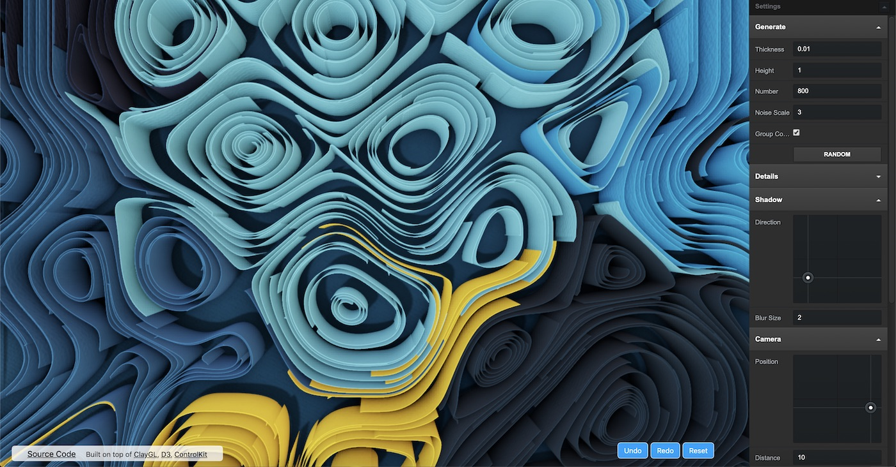
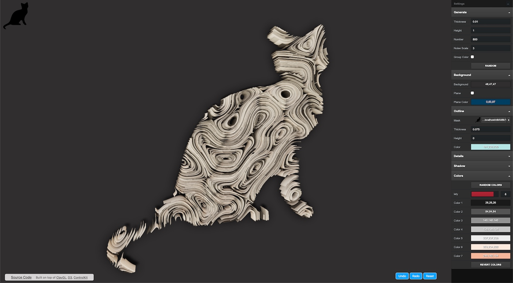

# Paper Quilling Art

Generate paper quilling artwork from a Perlin flow field and path trace it in the browser.





- Scene is built and managed with [three.js](https://threejs.org/).
- Rendering is done by [MuTracer](https://github.com/pissang/mutracer), a progressive WebGPU path tracer (WebGL 2 fallback) with OIDN denoising. `THREESync` keeps the three.js scene and the path tracer in sync.
- UI is built with React and [Mantine](https://mantine.dev/).

## Development

```bash
npm install
npm run dev
```

Open the printed URL in a browser with WebGPU (current Chrome, Edge or Safari). Append `?webgl` to force the WebGL 2 backend, or `?reset` to discard saved settings.

## Build

```bash
npm run build
```

The static site is written to `dist/`.

## Controls

- Left drag: orbit, scroll: zoom, right drag: spin the artwork.
- `⌘Z` / `⇧⌘Z`: undo / redo.
- **Snapshot** saves the current viewport image. **Render HQ** path traces a fixed size image offline at up to 4× the viewport resolution.
